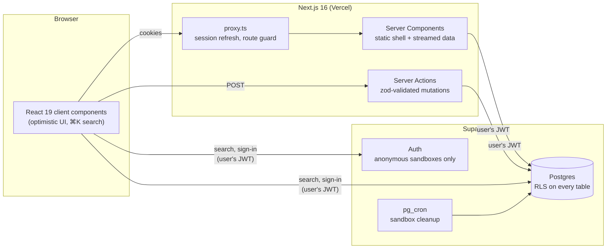

# TaskFlow

A calm task manager with focus sessions and weekly insights. Built as a
security-first full-stack portfolio piece: Next.js 16 on the front, Postgres
with Row Level Security underneath, and tests that prove one user can never
see or change another's data.

**Try it without signing up.** The demo gives every visitor a private
sandbox with sample tasks and three weeks of history. Only that visitor can
see it, and it's deleted after 7 days. There's no sign-up: TaskFlow is
demo-only by design, so it holds no emails or passwords at all.

## Features

- **Tasks** in Today, Upcoming, All and Completed, shaped like Reminders and Things 3.
- **Natural-language quick add**: `Call Danielle tomorrow 3pm #work !high` becomes a
  task with a due time, a tag and a priority, previewed as you type.
- **Details sheet**: a slide-over on desktop and a bottom sheet on phones, saved on close.
- **Focus**: a Pomodoro ring timer with work and break presets, full-screen mode,
  chimes with a mute toggle, and sessions logged against tasks. It survives reloads.
- **Insights**: weekly and monthly cards, a tap-for-detail daily chart and a
  plain-language summary of how the week went.
- **Fast by default**: a static shell with streamed data (Partial Prerendering),
  optimistic updates, skeletons, spring animations that respect reduced motion,
  and keyboard shortcuts (⌘K, N, F, Space, M).
- **Your time zone, not the server's**: "today", streaks and charts follow the
  visitor's calendar day, including across daylight-saving changes.

## Architecture



Every database call runs **as the signed-in user**, with their JWT, using the
public publishable key. No server code holds a key that bypasses Row Level
Security, so a bug in the app can't leak another user's rows: Postgres itself
refuses. The design decisions are written up in [`docs/adr`](docs/adr).

## Security

See [SECURITY.md](SECURITY.md) for the threat model, what was wrong with v1 and
how v2 fixes each issue. The short version:

- RLS owner-only policies on every table, composite foreign keys that stop
  cross-account links, and per-account row quotas.
- The user comes from the verified session, never from an ID the client sends.
- Every Server Action authenticates and validates its input with zod.
- Strict security headers and a Content Security Policy, with no third-party scripts.
- Demo-only accounts: anonymous sandboxes, no passwords or email addresses to
  leak. Email is switched off in Auth, and a database hook refuses to send
  any mail, so the project can't be used to email strangers.
- CI runs 29 database tests that attack the policies directly, plus
  end-to-end tests with two real browsers.

## Run it locally

Requirements: Node 22+, Docker Desktop.

```bash
npm install
npm run db:start            # local Supabase: Postgres, Auth
cp .env.example .env.local  # then paste the URL and publishable key it printed
npm run dev                 # http://localhost:3000
```

Click **Try the demo** to get a sandbox.

| Script             | What it does                                                       |
| ------------------ | ------------------------------------------------------------------ |
| `npm run check`    | Everything CI runs except e2e: types, lint, knip, tests, audit, build |
| `npm test`         | Unit tests (parser, dates, timer, stats)                           |
| `npm run test:db`  | RLS isolation tests against the local database                     |
| `npm run test:e2e` | Playwright on desktop and phone viewports                          |
| `npm run db:reset` | Re-apply all migrations from scratch                               |
| `npm run db:types` | Regenerate TypeScript types from the schema                        |

## Project layout

```
src/
  app/(app)/        Today, Upcoming, All, Completed, Focus, Insights, Settings
  app/actions/      Server Actions (tasks, focus, session)
  components/       shell, tasks, focus, insights
  lib/              pure logic: quick-add parser, zoned dates, timer, stats
  proxy.ts          session refresh and route guard
supabase/migrations schema, RLS policies, sandbox seed and cleanup
tests/db/           policy tests that run as real users
tests/e2e/          Playwright
docs/adr/           architecture decision records
```

## Custom chimes

Focus plays a synthesized bell until you drop `work-end.mp3` and
`break-end.mp3` into [`public/sounds`](public/sounds).

## History

v1 (Next.js 15 + MongoDB) is preserved at tag `v1.0.0`, and the earlier Express
version at `archive/v0-express`. v2 is a ground-up rebuild; see the
[changelog](CHANGELOG.md).
